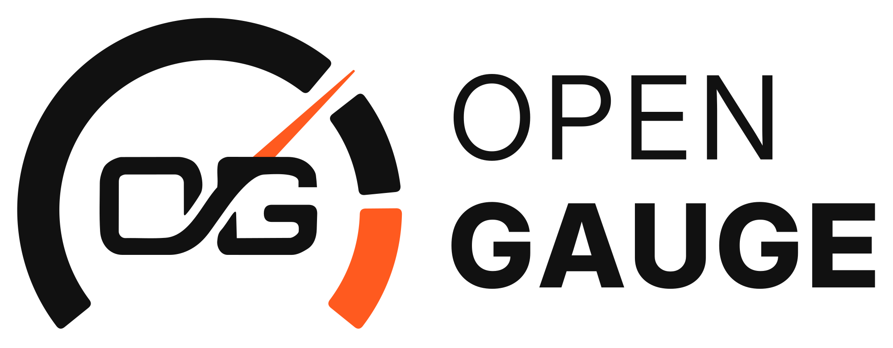

  <picture>
    <source media="(prefers-color-scheme: dark)" srcset="docs/logo-dark.png">
    <source media="(prefers-color-scheme: light)" srcset="docs/logo-light.png">
    
  </picture>

  
  
  

<b>Wireless digital gauges for your car, built on ESP32.</b> 
<b>English</b> · <a href="README.pt.md">Português</a>

  
  
  

  

An ESP32 **gateway** reads the ECU data from the CAN bus and sends it over ESP-NOW
to one or more **round displays**. No phone, account or internet connection is needed.

- **CAN read-only:** the gateway's CAN controller runs in listen-only mode, so it never transmits on the car's bus.
- **Signed data (ECDSA P-256):** every telemetry packet is signed by the gateway, and each display checks the signature before showing the values.

> [!WARNING]
> **Demo images, in development, not tested on hardware.**
> - For the bench only. The gateway image runs the **bench simulator**: it sends simulated data and does not read the CAN bus. Do not install it in a car.
> - All demo images of a version share one **test signing key**, which anyone can extract from the binary. It shows the data path works; it does not protect anything.

## Install in 3 steps
1. Open the [web installer](https://skydoy.github.io/OpenGauge/) in **Chrome** or **Edge** on a computer.
2. Pick the board and connect it by USB with a **data** cable.
3. Tick the confirmation and press **Install**. Install the gateway first, then each display, all from the **same version**.

You can reinstall from the web installer at any time. Each release lists its files with SHA-256 checksums (`SHA256SUMS.txt`).

## Boards

| Board | Role | Chip | Status |
|---|---|---|---|
| ESP32 board (e.g. ESP32 DevKit) | Gateway | ESP32 | Builds · bench simulator |
| [M5Stack M5 Dial v1.1](https://docs.m5stack.com/en/core/M5Dial) | 240×240 display (pilot) | ESP32-S3 | Builds · not tested on hardware |
| Elecrow CrowPanel 1.28″ rotary | 240×240 display | ESP32-S3 | Builds · not tested on hardware |

A board only counts as supported once it is confirmed on hardware.

## Release files
Each [release](https://github.com/skydoy/OpenGauge/releases) ships, per board:
- `*.factory.bin`: full image for the first USB install (address `0x0`);
- `*.ota.bin`: the application only;
- `SHA256SUMS.txt`, `LICENSE`, `NOTICE.md`, `SOURCE_OFFER.md` and `opengauge-licenses-v<version>.zip` (the [LICENSES](LICENSES/) folder).

The gateway and the displays only work together when they come from the same version: the test key changes every version.

## Status
- The source code is not public yet. It will be published in this repository at the end of phase 3.
- The binaries include arduino-esp32 (LGPL-2.1). Until the source is here, the [written source offer](SOURCE_OFFER.md) applies.
- So this repository does not take code contributions for now. Bugs and ideas:
  [issues](https://github.com/skydoy/OpenGauge/issues).
- Security issues: see [SECURITY.md](SECURITY.md).

## Support
[Ko-fi](https://ko-fi.com/skydoy) · [Buy Me a Coffee](https://buymeacoffee.com/skydoy)

---

[PolyForm Noncommercial 1.0.0](LICENSE): free for personal and non-commercial use, commercial use not allowed.
Third-party components: [NOTICE.md](NOTICE.md); full licence texts: [LICENSES/](LICENSES/); LGPL-2.1 source offer: [SOURCE_OFFER.md](SOURCE_OFFER.md).
Use at your own risk; do not use it in a vehicle on the road. M5Stack and Elecrow are trademarks of their owners;
this is an independent project, not affiliated with them. Board pictures are illustrations.
