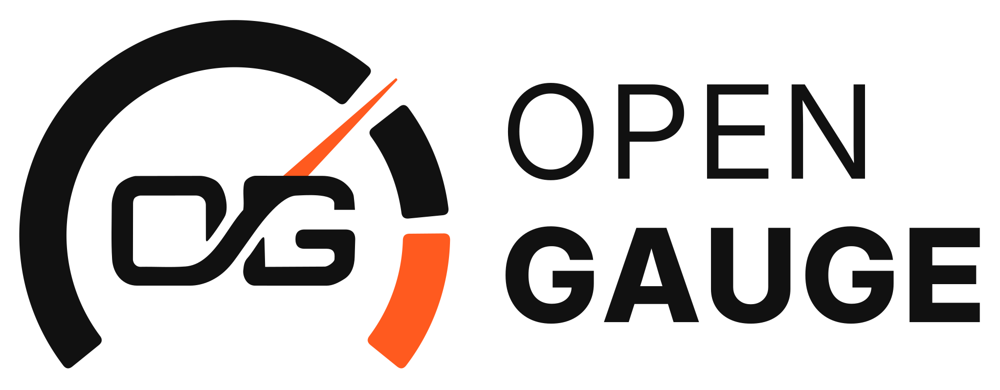

  <picture>
    <source media="(prefers-color-scheme: dark)" srcset="docs/logo-dark.png">
    <source media="(prefers-color-scheme: light)" srcset="docs/logo-light.png">
    
  </picture>

  
  
  

<b>Mostradores digitais sem fios para o carro, com ESP32.</b> 
<a href="README.md">English</a> · <b>Português</b>

  
  
  

  

Um **gateway** ESP32 lê os dados da centralina (ECU) pelo barramento CAN e envia-os
por ESP-NOW para um ou mais **ecrãs redondos**. Não precisa de telemóvel, conta nem Internet.

- **CAN só de leitura:** o controlador CAN do gateway trabalha em modo listen-only e nunca transmite no barramento do carro.
- **Dados assinados (ECDSA P-256):** cada pacote de telemetria é assinado pelo gateway e cada ecrã confere a assinatura antes de mostrar os valores.

> [!WARNING]
> **Imagens de demonstração, em desenvolvimento, sem teste em hardware.**
> - Só para bancada. A imagem do gateway corre o **simulador de bancada**: envia dados simulados e não lê o CAN. Não instale num carro.
> - Todas as imagens de demonstração de uma versão partilham uma **chave de assinatura de teste**, que qualquer pessoa pode extrair do binário. Mostra que a ligação funciona; não protege nada.

## Instalar em 3 passos
1. Abra o [instalador web](https://skydoy.github.io/OpenGauge/) no **Chrome** ou **Edge** num computador.
2. Escolha a placa e ligue-a por USB com um cabo **de dados**.
3. Marque a confirmação e carregue em **Instalar**. Instale primeiro o gateway e depois cada ecrã, todos da **mesma versão**.

Pode reinstalar pelo instalador web sempre que quiser. Cada release lista os ficheiros com as somas SHA-256 (`SHA256SUMS.txt`).

## Placas

| Placa | Função | Chip | Estado |
|---|---|---|---|
| Placa ESP32 (ex.: ESP32 DevKit) | Gateway | ESP32 | Compila · simulador de bancada |
| [M5Stack M5 Dial v1.1](https://docs.m5stack.com/en/core/M5Dial) | Ecrã 240×240 (piloto) | ESP32-S3 | Compila · sem teste em hardware |
| Elecrow CrowPanel 1.28″ rotativo | Ecrã 240×240 | ESP32-S3 | Compila · sem teste em hardware |

Uma placa só conta como suportada depois de confirmada em hardware.

## Ficheiros de cada versão
Cada [release](https://github.com/skydoy/OpenGauge/releases) traz, por placa:
- `*.factory.bin`: imagem completa para a primeira instalação por USB (endereço `0x0`);
- `*.ota.bin`: só a aplicação;
- `SHA256SUMS.txt`, `LICENSE`, `NOTICE.md`, `SOURCE_OFFER.md` e `opengauge-licenses-v<versão>.zip` (a pasta [LICENSES](LICENSES/)).

O gateway e os ecrãs só funcionam juntos se vierem da mesma versão: a chave de teste muda em cada versão.

## Estado
- O código-fonte ainda não é público. Vai ser publicado neste repositório no fim da fase 3.
- Os binários incluem o arduino-esp32 (LGPL-2.1). Até o código estar aqui, vale a [oferta escrita de código-fonte](SOURCE_OFFER.md).
- Por isso este repositório não aceita contribuições de código por agora. Problemas e sugestões:
  [issues](https://github.com/skydoy/OpenGauge/issues).
- Falhas de segurança: ver [SECURITY.md](SECURITY.md).

## Apoiar
[Ko-fi](https://ko-fi.com/skydoy) · [Buy Me a Coffee](https://buymeacoffee.com/skydoy)

---

[PolyForm Noncommercial 1.0.0](LICENSE): gratuito para uso pessoal e não comercial, uso comercial não permitido.
Componentes de terceiros: [NOTICE.md](NOTICE.md); textos completos das licenças: [LICENSES/](LICENSES/); oferta de código-fonte LGPL-2.1: [SOURCE_OFFER.md](SOURCE_OFFER.md).
Use por sua conta e risco; não use num veículo em circulação. M5Stack e Elecrow são marcas dos respetivos donos;
este é um projeto independente, sem ligação a estas marcas. As imagens das placas são ilustrações.
