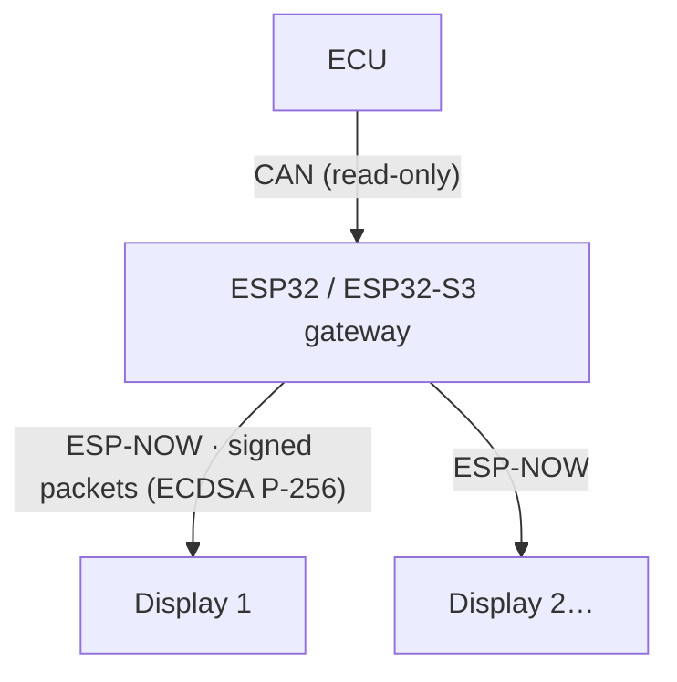

# How it works

## Gateway

- Reads the CAN bus with the ESP32's **TWAI** controller in **listen-only** mode: it sends no frames, no ACK and no error frames.
- Packs the values into a telemetry packet, **signs it** with ECDSA P-256 and sends it as an **ESP-NOW broadcast**, about **50 times per second** (every 20 ms).
- In the [demo images](demo.md) the CAN bus is not read: the values come from the **bench simulator**.

## Displays

- Receive the ESP-NOW packets and **check the signature** with the public key built into the image. Packets without a valid signature are rejected.
- Also reject replayed or old packets: each packet carries a sequence number and a gateway "epoch", and the display stores the highest epoch it has seen.
- With no valid packets for **2 seconds**, the display shows **DISCONNECTED**.

## What the display shows

In the current firmware, until the first valid packet arrives the display shows the **pairing mode** ("Aguardando telemetria do gateway…", waiting for gateway telemetry). Then it switches to the gauge:

| Value | Source in the packet |
|---|---|
| Engine speed (RPM), needle from 0 to 8000 | `rpm` |
| BOOST (bar) | intake pressure (kPa) − 100 |
| OIL (°C) | oil temperature |
| BAT (V) | battery voltage |

A value with no valid reading shows as `--`.

!!! note "Not tested on hardware"
    This describes the firmware in the published images. The displays have not been tested on a real unit yet.
