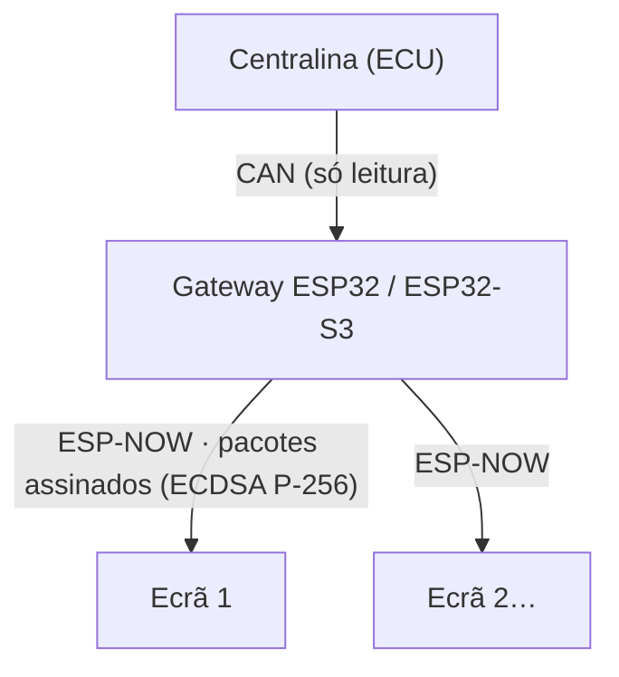

# Como funciona

## Gateway

- Lê o barramento CAN com o controlador **TWAI** do ESP32 em modo **listen-only**: não envia tramas, não dá ACK nem envia tramas de erro.
- Junta os valores num pacote de telemetria, **assina-o** com ECDSA P-256 e envia-o por **ESP-NOW em broadcast**, cerca de **50 vezes por segundo** (de 20 em 20 ms).
- Nas [imagens de demonstração](demo.md) o CAN não é lido: os valores vêm do **simulador de bancada**.

## Ecrãs

- Recebem os pacotes ESP-NOW e **conferem a assinatura** com a chave pública gravada na imagem. Pacotes sem assinatura válida são rejeitados.
- Rejeitam também pacotes repetidos ou antigos: cada pacote tem um número de sequência e uma «época» do gateway, e o ecrã guarda a época mais alta que já viu.
- Sem pacotes válidos durante **2 segundos**, o ecrã mostra **DISCONNECTED**.

## O que o ecrã mostra

No firmware atual, até receber o primeiro pacote válido o ecrã mostra o **modo de emparelhamento** («Aguardando telemetria do gateway…»). Depois passa ao mostrador:

| Valor | Origem no pacote |
|---|---|
| Rotação (RPM), ponteiro de 0 a 8000 | `rpm` |
| BOOST (bar) | pressão de admissão (kPa) − 100 |
| OIL (°C) | temperatura do óleo |
| BAT (V) | tensão da bateria |

Um valor sem leitura válida aparece como `--`.

!!! note "Sem teste em hardware"
    Isto descreve o firmware das imagens publicadas. Os ecrãs ainda não foram testados numa unidade real.
